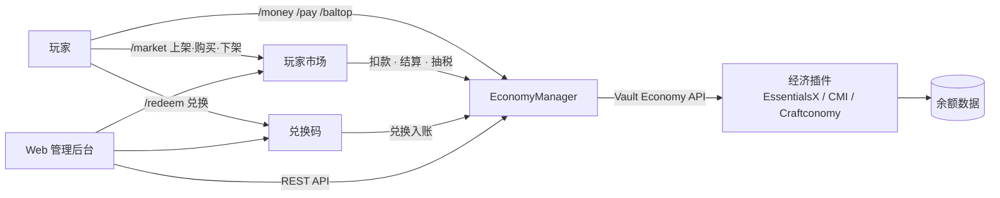

<div align="center">

# PluEssentials

**Minecraft 1.21.2 一体化服务端插件**
玩家功能 · 管理工具 · 经济系统 · 玩家市场 · 领地保护 · 内嵌 Web 管理后台


[功能](#功能特性) · [安装](#快速开始) · [配置](#配置说明) · [经济系统](#经济系统) · [命令](#命令) · [Web 后台](#web-管理后台) · [API](#rest-api) · [构建](#从源码构建)

**作者 / 开发者 / 仓库维护者：[stonestsy](https://github.com/stonestsy)**

</div>

---

## 简介

PluEssentials 把开服常用的功能收进**单个 jar**：玩家基础指令、管理员工具、安全管控、经济与交易、领地保护、登录系统、公告规则，以及一个**内嵌的 Web 管理后台**（JDK 自带 HttpServer，不需要额外部署 Nginx/Spring）。

不引入重量级框架，Web 前端为 Vue 3 构建产物，直接打进 jar；数据层支持 **MySQL** 与 **YAML** 两种后端，按需切换。

**经济是核心模块**：余额、转账、财富排行、玩家市场（GUI 交易）、兑换码发币、后台余额调整与成交记录管理形成闭环。经济能力通过 Vault 接入任意兼容的经济插件，详情见 [经济系统](#经济系统)。

| 项目 | 说明 |
|------|------|
| 版本 | 2.0.0 |
| 服务端 | Bukkit / Spigot / Paper 1.21.2 |
| Java | 21 |
| 产物 | `PluEssentials-2.0.0.jar`（约 4.9 MB，内含 MySQL 驱动与前端资源） |
| 软依赖 | Vault（经济）、LuckPerms（权限组），缺失时自动降级 |

---

## 功能特性

### 玩家功能

| 模块 | 命令 | 说明 |
|------|------|------|
| 家 | `/home` `/sethome` `/delhome` `/homes` | 多家支持，数量上限按权限分组 |
| 传送请求 | `/tpa` `/tpaccept` `/tpdeny` | 带超时，离线自动清理 |
| 死亡回传 | `/back` | 回到上次死亡位置 |
| 礼包 | `/kit` | 支持冷却时间 |
| 出生点 | `/spawn` | 管理员用 `/setspawn` 设置 |
| 地标 | `/warp` | 管理员用 `/setwarp` `/delwarp` 维护 |
| 经济 | `/money` `/pay` `/baltop` | 余额、转账、财富排行 |
| 玩家市场 | `/market` | GUI 商店，上架 / 购买 / 下架 |
| 领地 | `/claim` | 圈地 + 方块与容器保护 |
| 公告 | `/news` | 以**成书界面**展示 |
| 规则 | `/rules` | 以**成书界面**展示 |
| 登录 | `/register` `/login` | 未登录禁止移动、交互、聊天 |
| 兑换码 | `/redeem` | 兑换码换货币，限量 / 限时 / 一码一人一次 |

### 管理员功能

| 模块 | 命令 |
|------|------|
| 玩家状态 | `/fly` `/gamemode` `/heal` `/feed` `/god` `/vanish` `/speed` `/clear` |
| 背包查看 | `/invsee`（可编辑，带会话锁）、`/enderchest` |
| 封禁（UUID） | `/ban` `/tempban` `/unban` `/banlist` |
| 封禁（IP） | `/ipban` `/ipunban` `/ipbanlist`，登录阶段拦截 |
| 白名单 | `/whitelist on\|off\|add\|remove\|list`（别名 `/wl`） |
| 审计统计 | `/chatlog`（聊天记录）、`/seen`（首次登录 / 在线时长） |
| 强制操作 | `/sudo` `/healall` `/feedall` |
| 消息维护 | `/broadcast` `/plureload` `/setwarp` `/delwarp` |

### Web 管理后台

浏览器打开 `http://<服务器IP>:8080/` 即可管理：

- **仪表盘** — TPS、内存、在线人数、运行时长、Vault / LuckPerms 检测状态
- **玩家管理** — 踢出 / 治疗 / 喂食 / 击杀 / 无敌 / 飞行 / 清包 / 改模式 / 私聊 / 传送 / 查看背包 / 封禁
- **控制台** — 实时日志 + 执行任意命令
- **插件与世界** — 启停重载插件；时间 / 天气 / 难度
- **经济 · 玩家市场 · 领地 · 兑换码** — 全图形化管理
- **公告与规则** — 网页编辑，游戏内书本渲染
- **登录账号 · 封禁 · IP 封禁 · 白名单 · 聊天记录**
- **Warp · 定时任务（Cron）· 服务器控制**（关服 / 重载 / 广播）

---

## 快速开始

### 1. 环境要求

- 服务端 **Java 21**
- Minecraft **1.21.2**（Bukkit / Spigot / Paper）

### 2. 安装

```text
1. 下载 PluEssentials-2.0.0.jar
2. 放入服务端 plugins/ 目录
3. 启动服务端，自动生成 plugins/PluEssentials/ 配置与数据文件
4. （可选）安装 Vault + 经济插件 → 启用经济与市场
5. （可选）安装 LuckPerms      → 启用权限组管理
```

> **注意**：Vault 本身只是对接层，还需安装一个提供经济的插件（EssentialsX、CMI、Craftconomy 等），否则经济相关功能不可用，仪表盘会显示「Vault 已安装（缺少经济插件）」。

### 3. 登录后台

编辑 `plugins/PluEssentials/config.yml` 设置密码后重启（或 `/plureload`）：

```yaml
web:
  enabled: true
  host: "0.0.0.0"
  port: 8080
  password: "改成你的强密码"
```

浏览器访问 `http://<服务器IP>:8080/`。

---

## 配置说明

配置文件位于 `plugins/PluEssentials/config.yml`：

```yaml
prefix: "&7[&bPluEssentials&7] "

# ---------- Web 管理后台 ----------
web:
  enabled: true
  host: "0.0.0.0"          # 监听地址
  port: 8080               # 监听端口
  password: "admin123"     # 登录密码，生产环境务必修改
  token-expiry: 60         # 会话有效期（分钟）
  console-buffer: 500      # 控制台日志缓存行数
  external-web-dir: ""     # 外部前端目录，留空使用 jar 内嵌页面

# ---------- 数据存储 ----------
database:
  enabled: false           # true 使用 MySQL，false 使用 YAML 文件
  host: "localhost"
  port: 3306
  database: "pluessentials"
  username: "root"
  password: ""
  table-prefix: "plu_"     # 启动时自动建表

# ---------- 出生点 ----------
spawn:
  use-world-spawn: true    # 未设置出生点时使用世界出生点

# ---------- 白名单 ----------
whitelist:
  enabled: false           # /whitelist on|off 会同步修改此项

# ---------- 家 ----------
home:
  default-limit: 5
  limits:                  # 权限 plu.home.limit.<名称> 对应上限
    vip: 20
    admin: 50

# ---------- 传送请求 ----------
tpa:
  timeout: 60              # 秒

# ---------- 死亡回传 ----------
back:
  enabled: true
  death-message: "&cYou died! Use &e/back &cto return to your death point."

# ---------- 礼包 ----------
kits:
  starter:
    cooldown: 0
    items:
      - {material: STONE_SWORD, amount: 1}
      - {material: STONE_PICKAXE, amount: 1}
      - {material: COOKED_BEEF, amount: 16}
  vip:
    cooldown: 3600
    items:
      - {material: DIAMOND_SWORD, amount: 1}
      - {material: GOLDEN_APPLE, amount: 8}

# ---------- 玩家市场 ----------
market:
  tax-percent: 0           # 成交税率（百分比，0 = 免税）
  max-items-per-player: 10 # 每人最多上架数量

# ---------- 领地 ----------
claims:
  max-per-player: 2        # 每人最多领地数量
  max-radius: 16           # 单块最大半径（边长 = 2*半径+1）

# ---------- 自定义 TAB ----------
tab:
  enabled: true
  header: "&b&lPluEssentials &7| &f在线 &a{online}&7/&a{max}"
  footer: "&7世界: &a{world} &7| 余额: &a{balance} &7| 时间: &a{time}"

# ---------- 登录系统 ----------
login:
  enabled: true
```

### 公告与规则

`plugins/PluEssentials/announcements.yml`（首次启动自动生成，也可在 Web 后台「公告与规则」编辑）：

```yaml
news:
  title: "&6服务器公告"
  author: "服务器管理组"
  pages:
    - "&6欢迎来到服务器！"
    - "&7请遵守服务器规则，祝游戏愉快。"
rules:
  title: "&c服务器规则"
  author: "服务器管理组"
  pages:
    - "&c&l服务器规则\n&r1. 禁止作弊与使用外挂。"
    - "&r2. 禁止恶意 PVP 与刷屏。"
```

> **每个列表项 = 书本的一页**，支持 `&` 颜色代码与 `\n` 换行。

### TAB 占位符

| 占位符 | 含义 | 占位符 | 含义 |
|--------|------|--------|------|
| `{player}` | 玩家名 | `{balance}` | 余额（经济不可用显示 `N/A`） |
| `{online}` | 在线人数 | `{time}` | 现实时间 `HH:mm` |
| `{max}` | 最大人数 | `{world}` | 所在世界 |
| `{ping}` | 延迟（ms） | | |

TAB 每 5 秒刷新一次。

### 生产环境建议

- 修改 `web.password` 默认密码
- 用防火墙限制 8080 端口来源，或经 Nginx 反代并启用 HTTPS
- MySQL 避免空密码
- 切换存储后端**不会自动迁移数据**，请先手动导出导入

---

## 经济系统

经济是本项目的核心模块之一，由 **货币操作 + 玩家市场 + 兑换码 + 财富排行 + 后台管理** 五部分组成。

> 重要：**余额数据由 Vault 背后的经济插件保管**，PluEssentials 不另存一份余额，只负责调用与展示。因此换经济插件会换掉玩家余额，但市场与兑换码的记录仍在本插件的数据表里。



### 1. 依赖与启用

| 必需 | 说明 |
|------|------|
| **Vault** | 经济服务对接层，仅安装它**不会**产生任何货币 |
| **一个经济插件** | 真正提供余额与货币单位，如 EssentialsX、CMI、Craftconomy3 等实现了 Vault `Economy` 接口的插件 |

不需要在 `config.yml` 里开启任何开关——插件启动时自动探测，探测不到就静默降级（相关命令会提示不可用）。

**检测机制**：`VaultHook.isAvailable()` 为懒检测。经济插件若晚于 PluEssentials 加载（很常见），下一次调用会自动重试注册查询，**无需重启或 reload**。

**状态对照**（仪表盘顶部标签 / `/api/dashboard` 字段）：

| 现象 | `vaultInstalled` | `vaultEnabled` | 原因 |
|------|------------------|----------------|------|
| 一切正常 | `true` | `true` | Vault + 经济插件均已就绪 |
| 「Vault 已安装（缺少经济插件）」 | `true` | `false` | 装了 Vault，但没有插件提供 Economy 服务 |
| 「Vault 经济（未安装）」 | `false` | `false` | 完全没装 Vault |

### 2. 货币操作

| 命令 | 别名 | 权限 | 说明 |
|------|------|------|------|
| `/money` | `/bal` `/balance` | `plu.money` | 查看自己的余额，数值经经济插件 `Economy#format` 格式化（含货币单位） |
| `/money <player>` | 同上 | `plu.money.others` | 查看他人余额（默认仅 OP） |
| `/pay <player> <金额>` | — | `plu.pay` | 向在线玩家转账 |
| `/baltop [数量]` | `/balancetop` | `plu.baltop` | 财富排行榜 |

**行为细节**

- `/pay` 仅玩家可用；目标必须在线；**不能给自己转账**；金额必须 > 0
- 转账先扣款再入账，**余额不足直接失败且不扣款**，并回显当前余额
- 转账成功双方都会收到到账 / 支出提示
- `/baltop` 只统计余额 > 0 的玩家，按余额降序；默认 10 条，最多 50 条
- 排行榜结果**缓存 5 分钟**，避免每次都遍历全部离线玩家（首次查询在玩家量大时会有短暂耗时）

### 3. 玩家市场

玩家之间自由交易的 GUI 商店，货币结算走 Vault。

#### 使用流程

```text
上架：手持物品 → /market sell <价格> → 物品从手上扣除并进入市场
浏览：/market            → 打开 GUI，点击商品即可购买
管理：/market my         → 列出自己的上架（含编号）
下架：/market remove <编号> → 物品退回背包
```

#### GUI 布局

```text
┌──────────────────────────────────────────────────┐
│  0   1   2   3   4   5   6   7   8  ...   44     │  45 个商品位
├──────────────────────────────────────────────────┤
│ 45[上一页]   ·   ·   49[我的上架]   ·   ·  53[下一页] │  灰色玻璃板填充
└──────────────────────────────────────────────────┘
```

每个商品图标保留原物品外观，lore 追加卖家、价格、编号与「点击购买」。

#### 交易规则

| 场景 | 行为 |
|------|------|
| 购买自己上架的物品 | 拒绝 |
| 背包已满（无空位） | 拒绝，提示腾出空间 |
| 余额不足 | 拒绝，提示所需金额 |
| 正常成交 | 买家扣款 → 按税率抽税 → 卖家入账 → 物品进背包 → 刷新界面 |
| 卖家在线 | 收到「已售出 + 收入（含税额说明）」通知 |
| 卖家离线 | 收入直接入账，下次登录可查余额 |
| 下架 | 校验归属（管理员可用 `plu.market.admin` 越权），背包满则拒绝取回 |

#### 配置

```yaml
market:
  tax-percent: 0           # 成交税率（百分比）。5 表示每笔交易抽 5%，0 为免税
  max-items-per-player: 10 # 每人同时上架的上限
```

#### 物品保真

上架物品使用 `BukkitObjectOutputStream` 序列化后 Base64 存入 `plu_market.item`，**完整保留**附魔、耐久、自定义名称、lore、NBT，不会退化为白板物品。

### 4. 兑换码

用于活动发币、补偿、推广，一个码可限制总次数与有效期。

| 命令 | 权限 | 说明 |
|------|------|------|
| `/redeem <兑换码>` | `plu.redeem` | 兑换货币，成功即时到账（别名 `/cdkey`） |
| `/redeem create <兑换码\|#> <金额> [次数] [时长]` | `plu.redeem.admin` | 创建；`#` 表示自动生成 8 位随机码 |
| `/redeem list` | `plu.redeem.admin` | 查看全部码、使用次数与到期时间 |
| `/redeem toggle <兑换码>` | `plu.redeem.admin` | 启用 / 停用（不删除，可随时恢复） |
| `/redeem delete <兑换码>` | `plu.redeem.admin` | 删除，同时清理兑换记录 |

**参数含义**

| 参数 | 说明 |
|------|------|
| 金额 | 必填，必须 > 0 |
| 次数 | 整服总可用次数，`0` = 不限；默认 `1` |
| 时长 | `7d` / `12h` / `30m` / `1w`；`0` 或留空 = 永久 |
| 兑换码 | 自动转大写存储，输入不区分大小写 |

**规则与边界**

- **一码一人一次**：同一玩家对同一个码只能兑换一次，与总次数限制相互独立（`plu_redeem_uses` 联合主键 `code + uuid` 兜底）
- 随机码字符集为 `A-HJ-NP-Z2-9`（剔除 `0/O/1/I`），避免口头传播时认错
- 兑换失败不会产生任何扣减，提示明确区分原因：

| 提示 | 触发条件 |
|------|----------|
| 兑换码不存在 | 码未创建 |
| 该兑换码已被停用 | `enabled = false` |
| 该兑换码已过期 | 已过到期时间 |
| 该兑换码已被用完 | 达到总次数上限 |
| 你已经兑换过这个码了 | 同一玩家重复兑换 |
| 经济系统不可用 | 未检测到 Vault 经济服务 |

**示例**

```text
# 前 100 名玩家各领 500，30 天内有效
/redeem create WELCOME2026 500 100 30d

# 生成一次性随机码，7 天有效
/redeem create # 1000 1 7d

# 停用但仍保留记录（便于追溯）
/redeem toggle WELCOME2026
```

### 5. 后台与接口

**Web 后台页面**

| 页面 | 能力 |
|------|------|
| 经济系统 | 按玩家名查询余额，执行 `set` / `add` / `remove` |
| 玩家市场 | 查看全部上架（卖家、物品、价格、时间），删除违规上架 |
| 兑换码 | 新建（含随机码）、启用 / 停用、删除，状态用标签区分可用 / 已停用 / 已过期 |

**REST API**

| 方法 | 路径 | 说明 |
|------|------|------|
| GET | `/api/economy/{player}` | 查询余额，返回 `player` / `balance` / `currency` |
| POST | `/api/economy/{player}/{set\|add\|remove}` | 请求体 `{"amount":100}`，返回最新余额 |
| GET | `/api/market` | 上架列表（含 `available` 表示经济是否可用） |
| DELETE | `/api/market/{id}` | 删除上架 |
| GET | `/api/redeem` | 兑换码列表（含 `expired` 标记） |
| POST | `/api/redeem` | `{"code":"WELCOME","amount":500,"maxUses":50,"duration":"30d"}` |
| POST | `/api/redeem/{code}/toggle` | 启用 / 停用 |
| DELETE | `/api/redeem/{code}` | 删除 |

经济接口在 Vault 不可用时返回 `503`，便于调用方区分「服务未就绪」与「参数错误」。

### 6. 数据落点

| 数据 | 存放位置 |
|------|----------|
| 玩家余额 | **经济插件自己的存储**（PluEssentials 不落库） |
| 市场挂单 | `plu_market`：`id / seller / seller_name / item / price / created` |
| 兑换码定义 | `plu_redeem_codes`：`code / amount / max_uses / used_count / expires / created / creator / enabled` |
| 兑换记录 | `plu_redeem_uses`：`code / uuid / used_at`（联合主键防重复） |

YAML 模式下分别落在 `market.yml`、`redeem.yml`。**切换存储后端不会自动迁移**。

### 7. 运维建议

- **税率**：`tax-percent` 建议设 3~10，作为服务器回收货币的水槽；设为 0 则市场纯流通
- **上架上限**：`max-items-per-player` 建议 5~15，过高会让 GUI 翻页过多、审核困难
- **兑换码**：批量发币时优先用「总次数 + 有效期」双限制，避免链接泄露后被无限领取；活动结束后用 `toggle` 停用而不是删除，保留审计痕迹
- **余额调整**：后台的 `add` / `set` 会直接写入经济插件，属于强操作，建议操作前先 `/money <玩家>` 记录原值
- **备份**：余额随经济插件备份；市场与兑换码随本插件的数据表或 YAML 备份，两者要一起备份才能完整还原

---

## 命令

> 约定：`<参数>` 必填，`[参数]` 可选；消息支持 `&` 颜色代码。
> 详细用法与权限见下方折叠区块。

<details open>
<summary><b>玩家命令</b></summary>

| 命令 | 权限 | 说明 |
|------|------|------|
| `/homes` | `plu.homes` | 列出自己的家 |
| `/home [name]` | `plu.home` | 传送到家，默认 `home` |
| `/sethome [name]` | `plu.sethome` | 设置家 |
| `/delhome <name>` | `plu.delhome` | 删除家 |
| `/tpa <player>` | `plu.tpa` | 请求传送到目标玩家 |
| `/tpaccept` / `/tpdeny` | `plu.tpa` | 接受 / 拒绝请求 |
| `/back` | `plu.back` | 回到死亡地点 |
| `/kit [name]` | `plu.kit` | 领取礼包，省略则列出 |
| `/spawn` | `plu.spawn` | 传送到出生点 |
| `/warp [name]` | `plu.warp` | 传送到地标，省略则列出 |
| `/money [player]` | `plu.money` / `plu.money.others` | 查询余额（别名 `/bal`） |
| `/pay <player> <金额>` | `plu.pay` | 转账 |
| `/baltop [数量]` | `plu.baltop` | 财富排行（默认 10，缓存 5 分钟） |
| `/market` | `plu.market` | 打开市场 GUI（别名 `/ah`） |
| `/market sell <价格>` | `plu.market` | 上架手持物品 |
| `/market my` | `plu.market` | 我的上架 |
| `/market remove <编号>` | `plu.market` | 下架并取回 |
| `/claim create [半径]` | `plu.claim` | 创建领地（默认半径 5） |
| `/claim list` | `plu.claim` | 我的领地 |
| `/claim remove <编号>` | `plu.claim` | 删除领地 |
| `/claim info` | `plu.claim` | 查看所在位置归属 |
| `/news` | `plu.news` | 公告（书本界面，别名 `/announcements`） |
| `/rules` | `plu.rules` | 规则（书本界面） |
| `/register <密码>` | — | 注册（4-32 位，成功自动登录） |
| `/login <密码>` | — | 登录 |
| `/redeem <兑换码>` | `plu.redeem` | 兑换货币（别名 `/cdkey`） |

</details>

<details>
<summary><b>管理员命令</b></summary>

| 命令 | 别名 | 权限 | 说明 |
|------|------|------|------|
| `/fly [player]` | — | `plu.fly` | 切换飞行 |
| `/gamemode <mode> [player]` | `/gm` | `plu.gamemode` | survival / creative / adventure / spectator 或 0-3 |
| `/heal [player]` | — | `plu.heal` | 满血满食灭火 |
| `/feed [player]` | — | `plu.feed` | 满食满饱和 |
| `/god [player]` | — | `plu.god` | 切换无敌 |
| `/vanish [player]` | `/v` | `plu.vanish` | 切换隐身 |
| `/speed <1-10> [player]` | — | `plu.speed` | 设置行走 / 飞行速度 |
| `/clear [player]` | `/ci` | `plu.clear` | 清空背包 |
| `/invsee <player>` | — | `plu.invsee` | 查看并编辑背包（会话锁） |
| `/enderchest [player]` | `/ec` | `plu.enderchest` | 查看末影箱 |
| `/ban <player> [reason]` | — | `plu.ban` | 永久封禁 |
| `/tempban <player> <duration> [reason]` | — | `plu.ban` | 限时封禁 |
| `/unban <player>` | — | `plu.ban` | 解封 |
| `/banlist` | — | `plu.ban` | 封禁列表 |
| `/ipban <ip\|player> [reason]` | — | `plu.ipban` | IP 封禁（传在线玩家名自动取 IP） |
| `/ipunban <ip>` | — | `plu.ipban` | 解封 IP |
| `/ipbanlist` | — | `plu.ipban` | IP 封禁列表 |
| `/whitelist <on\|off\|add\|remove\|list> [player]` | `/wl` | `plu.whitelist` | 白名单管理 |
| `/chatlog [count\|keyword]` | — | `plu.chatlog` | 聊天记录：数字=条数，文本=搜索 |
| `/seen <player>` | — | `plu.seen` | 首次登录 / 最后在线 / 累计时长 |
| `/sudo <player> <command>` | — | `plu.sudo` | 强制玩家执行命令 |
| `/healall` / `/feedall` | — | `plu.healall` / `plu.feedall` | 群体治疗 / 喂食 |
| `/broadcast <message>` | `/bc` | `plu.broadcast` | 全服广播 |
| `/setspawn` | — | `plu.setspawn` | 设置出生点 |
| `/setwarp <name>` | — | `plu.setwarp` | 创建地标 |
| `/delwarp <name>` | — | `plu.delwarp` | 删除地标 |
| `/plureload` | — | `plu.reload` | 重载配置与全部管理器 |
| `/redeem create <兑换码\|#> <金额> [次数] [时长]` | — | `plu.redeem.admin` | 创建兑换码 |
| `/redeem list` / `toggle` / `delete` | — | `plu.redeem.admin` | 兑换码管理 |

</details>

### 时长格式

`/tempban`、`/redeem` 与 Web API 通用：`数字 + 单位`

| 后缀 | 单位 | 示例 |
|------|------|------|
| `s` | 秒 | `30s` |
| `m` | 分钟 | `15m` |
| `h` | 小时 | `2h` |
| `d` | 天 | `7d` |
| `w` | 周 | `1w` |

`0` 或留空 = 永久。

### 常用示例

```text
# 经济与市场
/pay Steve 100
/market sell 500            # 手持物品以 500 上架
/claim create 8             # 以自己为中心 17x17 领地

# 兑换码：500 货币，限前 50 人，30 天有效
/redeem create WELCOME2026 500 50 30d
/redeem create # 100 1 7d   # 随机一次性码

# 安全
/tempban Steve 1d 使用外挂
/ipban BadGuy 恶意刷屏
/whitelist add Alex
/whitelist on

# 审计
/chatlog 30
/seen Steve
```

### 权限节点

<details>
<summary>展开完整权限表</summary>

| 权限 | 默认 | 用途 |
|------|------|------|
| `plu.home` `plu.sethome` `plu.delhome` `plu.homes` | 所有人 | 家系统 |
| `plu.tpa` `plu.back` `plu.kit` `plu.spawn` `plu.warp` | 所有人 | 基础玩家功能 |
| `plu.home.limit.<名称>` | — | 家数量上限（配合 `home.limits`） |
| `plu.money` `plu.pay` `plu.baltop` | 所有人 | 经济 |
| `plu.money.others` | OP | 查看他人余额 |
| `plu.market` | 所有人 | 玩家市场 |
| `plu.market.admin` | OP | 删除任意上架 |
| `plu.claim` | 所有人 | 领地 |
| `plu.claim.bypass` | OP | 无视领地保护 |
| `plu.claim.admin` | OP | 删除任意领地 |
| `plu.rules` `plu.news` | 所有人 | 公告与规则 |
| `plu.redeem` | 所有人 | 兑换码兑换 |
| `plu.redeem.admin` | OP | 管理兑换码 |
| `plu.login.bypass` | OP | 跳过登录要求 |
| `plu.setspawn` `plu.setwarp` `plu.delwarp` | OP | 维护类 |
| `plu.fly` `plu.gamemode` `plu.heal` `plu.feed` `plu.god` `plu.vanish` `plu.speed` `plu.clear` | OP | 玩家状态 |
| `plu.invsee` `plu.enderchest` | OP | 背包查看 |
| `plu.ban` `plu.ipban` `plu.whitelist` | OP | 安全管控 |
| `plu.chatlog` `plu.seen` | OP | 审计统计 |
| `plu.sudo` `plu.healall` `plu.feedall` | OP | 强制与群体操作 |
| `plu.broadcast` `plu.reload` | OP | 消息与维护 |

</details>

---

## Web 管理后台

插件内嵌 `com.sun.net.httpserver.HttpServer`，前端为 Vue 3 + Element Plus 构建产物，随 jar 一起分发。

| 项目 | 说明 |
|------|------|
| 默认地址 | `http://<服务器IP>:8080/` |
| 登录方式 | 密码登录，换取 Bearer Token |
| Token 有效期 | `web.token-expiry` 分钟（默认 60） |
| 前端来源 | jar 内 `web/` 资源；`web.external-web-dir` 可指向外部目录做热更新 |

**页面清单**：仪表盘、玩家管理、控制台、插件管理、世界管理、经济系统、玩家市场、领地管理、兑换码、公告与规则、登录账号、封禁管理、IP 封禁、白名单、聊天记录、Warp 管理、定时任务、服务器控制。

---

## REST API

所有接口返回 UTF-8 JSON。除登录外需携带请求头：

```http
Authorization: Bearer <token>
```

错误统一为 `{ "error": "描述" }`，状态码 `400` 参数错误 / `401` 未授权 / `404` 不存在 / `503` 依赖不可用。

<details open>
<summary><b>认证与仪表盘</b></summary>

| 方法 | 路径 | 说明 |
|------|------|------|
| POST | `/api/login` | `{"password":"..."}` → `{"token":"..."}`，失败 401 |
| POST | `/api/logout` | 吊销 Token |
| GET | `/api/dashboard` | TPS、内存、在线人数、`vaultEnabled` / `vaultInstalled` / `luckpermsEnabled` |

</details>

<details>
<summary><b>玩家 / 控制台 / 插件 / 世界</b></summary>

| 方法 | 路径 | 说明 |
|------|------|------|
| GET | `/api/players` | 在线玩家列表（含血量、模式、IP、延迟、余额） |
| POST | `/api/players/{name}/{action}` | `kick` `heal` `feed` `kill` `god` `fly` `clear` `gamemode` `message` `teleport` `inventory` `ban` |
| GET | `/api/console?lines=200` | 控制台日志 |
| POST | `/api/console` | `{"command":"..."}` |
| GET | `/api/plugins` | 插件列表 |
| POST | `/api/plugins/{name}/{action}` | `enable` `disable` `reload` |
| GET | `/api/worlds` | 世界列表（时间、天气、难度、种子） |
| POST | `/api/worlds/{name}/{action}` | `time` `day` `night` `weather` `difficulty` |

</details>

<details>
<summary><b>经济 / 权限 / 家 / 市场 / 领地</b></summary>

| 方法 | 路径 | 说明 |
|------|------|------|
| GET | `/api/economy/{player}` | 余额与货币名（需 Vault） |
| POST | `/api/economy/{player}/{set\|add\|remove}` | `{"amount":100}` |
| GET | `/api/permissions/{player}` | 主组与组列表（需 LuckPerms） |
| GET | `/api/homes/{player}` | 家列表与上限 |
| GET | `/api/market` | 上架列表 |
| DELETE | `/api/market/{id}` | 删除上架 |
| GET | `/api/claims` | 领地列表（范围、面积） |
| DELETE | `/api/claims/{id}` | 删除领地 |

</details>

<details>
<summary><b>公告 / 账号 / 兑换码</b></summary>

| 方法 | 路径 | 说明 |
|------|------|------|
| GET | `/api/announcements` | 公告与规则内容 |
| POST | `/api/announcements/{news\|rules}` | `{"pages":["第一页","第二页"]}` |
| GET | `/api/accounts` | 已注册账号与登录状态 |
| GET | `/api/redeem` | 兑换码列表 |
| POST | `/api/redeem` | `{"code":"WELCOME","amount":500,"maxUses":50,"duration":"30d"}` |
| POST | `/api/redeem/{code}/toggle` | 启用 / 停用 |
| DELETE | `/api/redeem/{code}` | 删除 |

</details>

<details>
<summary><b>封禁 / 白名单 / 审计 / Warp / 任务 / 服务器</b></summary>

| 方法 | 路径 | 说明 |
|------|------|------|
| GET POST DELETE | `/api/bans`、`/api/bans/{uuid}` | UUID 封禁 |
| GET POST DELETE | `/api/ipbans`、`/api/ipbans/{ip}` | IP 封禁 |
| GET POST DELETE | `/api/whitelist`、`/api/whitelist/{uuidOrName}` | 白名单（路径支持名字或 UUID） |
| GET | `/api/chat?limit=50&player=Steve` | 聊天记录 |
| GET | `/api/stats/{player}` | 玩家统计 |
| GET POST DELETE | `/api/warps`、`/api/warps/{name}` | 地标 |
| GET POST PUT DELETE | `/api/tasks`、`/api/tasks/{id}` | 定时任务（Cron） |
| POST | `/api/tasks/{id}/run` | 立即执行 |
| POST | `/api/broadcast` | `{"message":"..."}` |
| POST | `/api/server/stop` | `{"delay":5}` |
| POST | `/api/server/reload` | `Bukkit.reload()` |

</details>

---

## 数据存储

由 `database.enabled` 切换，代码层对两种后端透明：

| 后端 | 位置 |
|------|------|
| YAML | `plugins/PluEssentials/*.yml`（按模块拆分） |
| MySQL | `plu_*` 表，启动时自动建表，前缀可配 |

<details>
<summary>展开数据表结构</summary>

| 表 | 字段 | 说明 |
|----|------|------|
| `plu_bans` | uuid, name, reason, banner, created, expires | UUID 封禁 |
| `plu_ipbans` | ip, reason, banner, created, expires | IP 封禁 |
| `plu_whitelist` | uuid, name | 白名单 |
| `plu_homes` | uuid, name, world, x, y, z, yaw, pitch | 家（联合主键） |
| `plu_warps` | name, world, x, y, z, yaw, pitch | 地标 |
| `plu_tasks` | id, name, command, cron, enabled, last_run | 定时任务 |
| `plu_chatlog` | id, time, name, uuid, world, message | 聊天记录 |
| `plu_playerstats` | uuid, name, first_join, last_seen, playtime | 玩家统计 |
| `plu_market` | id, seller, seller_name, item, price, created | 市场上架（物品 Base64） |
| `plu_claims` | id, owner, owner_name, world, min_x, min_z, max_x, max_z, created | 领地 |
| `plu_accounts` | uuid, name, salt, hash, registered | 登录账号（加盐哈希） |
| `plu_redeem_codes` | code, amount, max_uses, used_count, expires, created, creator, enabled | 兑换码 |
| `plu_redeem_uses` | code, uuid, used_at | 兑换记录（防重复） |

</details>

---

## 从源码构建

### 环境

- JDK 21
- Maven 3.9+
- Node.js 20+（仅前端构建需要）

### 步骤

```bash
# 1. 构建前端
cd web-frontend
npm install
npm run build

# 2. 将前端产物复制到插件资源（Windows PowerShell）
Remove-Item -Recurse -Force src/main/resources/web
Copy-Item -Recurse web-frontend/dist src/main/resources/web

# 3. 构建插件
cd ..
mvn clean package
```

产物：`target/PluEssentials-2.0.0.jar`

> 后端编译启用了 `-Xlint:all,-classfile`，构建输出 0 警告。
> MySQL 驱动与 Vue 资源由 `maven-shade-plugin` 打入 jar，最终约 4.9 MB。

## 项目结构

```text
plu/
├── pom.xml                     # Maven 配置（shade 打包 MySQL 驱动）
├── src/main/
│   ├── java/com/plu/plugin/
│   │   ├── Main.java           # 主类：生命周期、命令注册、管理器装配
│   │   ├── commands/
│   │   │   ├── user/           # 玩家命令
│   │   │   └── admin/          # 管理员命令
│   │   ├── gui/                # 市场 GUI、书本界面
│   │   ├── listeners/          # 登录检查、聊天审计、领地保护、市场交互
│   │   ├── managers/           # 各业务管理器（MySQL / YAML 双后端）
│   │   ├── storage/            # DatabaseManager：连接与自动建表
│   │   ├── util/               # 玩家解析、数值转换工具
│   │   └── web/                # HttpServer、路由、鉴权、软依赖适配
│   └── resources/
│       ├── plugin.yml          # 命令与权限声明
│       ├── config.yml          # 默认配置
│       └── web/                # 前端构建产物（打入 jar）
└── web-frontend/               # Vue 3 + Vite + Element Plus 源码
```

### 架构要点

- **无外部 Web 框架**：仅用 JDK 内置 HttpServer，单 jar 交付；请求线程中修改 Bukkit 状态的操作通过 `Bukkit.getScheduler().runTask` 回到主线程。
- **双存储后端**：管理器统一构造签名 `XxxManager(Main plugin, DatabaseManager db)`，内部按 `db.isEnabled()` 分流。
- **软依赖懒检测**：Vault 经济服务在插件加载后再注册也能自动恢复；LuckPerms 走反射，不产生编译期硬依赖。
- **前端可热更新**：`web.external-web-dir` 指向外部目录即可绕过 jar 内资源。

---

## 常见问题

<details>
<summary><b>仪表盘显示「Vault 已安装（缺少经济插件）」</b></summary>

Vault 本身不提供经济，需再安装 EssentialsX、CMI 等经济插件。插件会自动重试检测，无需重启。
</details>

<details>
<summary><b>市场打不开，提示经济系统不可用</b></summary>

同上，市场依赖经济系统做扣款与结算。
</details>

<details>
<summary><b><code>/baltop</code> 为空或数据不全</b></summary>

排行只统计**余额大于 0** 的玩家并缓存 5 分钟。刚调整过余额需要等缓存过期，或执行 `/plureload` 刷新；玩家量大时首次统计会有短暂延迟。
</details>

<details>
<summary><b>市场成交后卖家没收到钱</b></summary>

款项直接写入经济插件（卖家离线也会入账），先确认经济插件本身的余额是否正确。若开启了 `market.tax-percent`，卖家实际到账为「价格 − 税额」，税额部分直接销毁不上缴，可用于回收货币。
</details>

<details>
<summary><b>兑换码提示「你已经兑换过这个码了」</b></summary>

同一玩家对同一个码只能兑换一次，这是独立于总次数的防刷机制。需要给同一玩家重复发币时，请新建一个兑换码。
</details>

<details>
<summary><b>换经济插件后玩家余额没了</b></summary>

余额由经济插件自己存储，PluEssentials 只调用不落库。更换经济插件等于更换了余额数据源，市场挂单与兑换码仍在 `plu_market` / `plu_redeem_*` 中，可在后台查看。
</details>

<details>
<summary><b>领地创建失败提示重叠</b></summary>

领地是二维矩形（不限高度），与已有领地范围相交即失败。换个位置或先删除已有领地。
</details>

<details>
<summary><b>玩家登录后仍被限制移动</b></summary>

确认已执行 `/register` 或 `/login`；`login.enabled: false` 可整体关闭登录要求，`plu.login.bypass` 权限可跳过。
</details>

<details>
<summary><b>修改配置后不生效</b></summary>

执行 `/plureload`，或在后台「服务器控制」重载插件。
</details>

<details>
<summary><b>切换 MySQL 后旧数据丢失</b></summary>

两种后端不自动迁移，切换前请先备份 YAML 并手动导入。
</details>

---

## 作者

<table>
<tr><td><b>作者</b></td><td>stonestsy</td></tr>
<tr><td><b>开发者</b></td><td>stonestsy</td></tr>
<tr><td><b>仓库维护者</b></td><td>stonestsy</td></tr>
</table>

欢迎提交 Issue 与 Pull Request。反馈问题时请附上：服务端类型与版本、Java 版本、插件版本、完整报错堆栈。

## 许可

本项目基于 [MIT License](LICENSE) 开源，Copyright (c) 2026 stonestsy。

你可以自由使用、修改、分发与商用，只需保留原始版权声明与许可声明。

---

<div align="center">
<sub>Built with Java 21 · Bukkit API 1.21 · Vue 3</sub>
</div>
